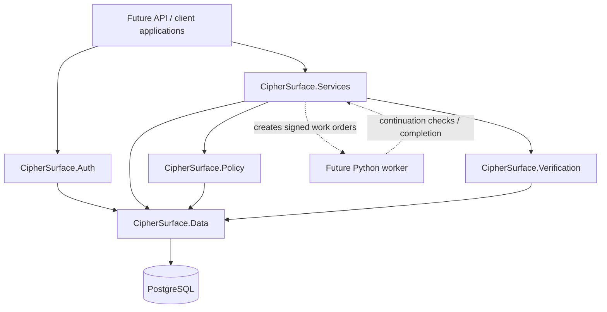
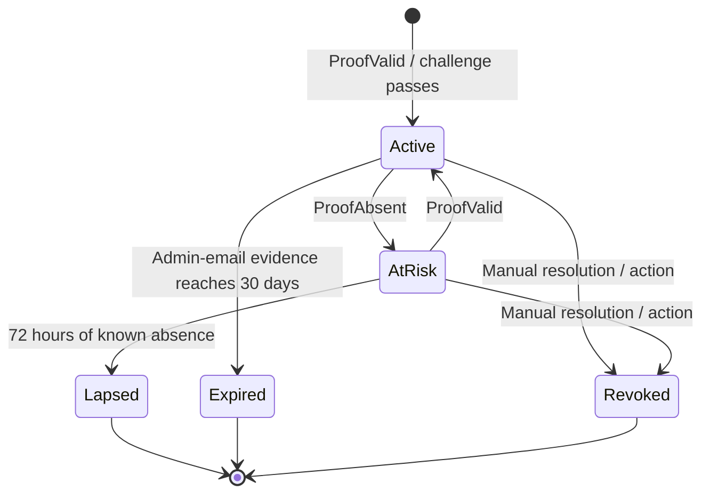

# CipherSurface

**A domain-verification, ownership-evidence, and scan-authorization foundation for an External Exposure Management platform.**

CipherSurface is being developed as a Final Year Project (FYP). Its current implementation establishes the security and authorization foundation that must be in place before passive external-asset discovery and exposure analysis can safely run. The repository focuses on proving control of a domain, defining exactly which hosts that proof permits, deciding whether a scan may start, and continuously enforcing that decision while a scan is running.

> **Current repository scope:** This ZIP contains the data model, policy engine, ownership verifiers, service-layer orchestration, authentication building blocks, and automated tests. It does **not** currently contain the ASP.NET Core API host/controllers, Hangfire job registration/scheduler, Python worker implementation, Angular frontend, discovery pipeline, or committed EF Core migration files. Those boundaries are listed explicitly below so that implemented capabilities are not confused with planned integration work.

---

## Table of contents

- [Project goals](#project-goals)
- [What is implemented](#what-is-implemented)
- [Architecture](#architecture)
- [Repository structure](#repository-structure)
- [Technology stack](#technology-stack)
- [Core concepts and workflows](#core-concepts-and-workflows)
  - [Organization and account model](#1-organization-and-account-model)
  - [Domain onboarding and authorization grant](#2-domain-onboarding-and-authorization-grant)
  - [Ownership verification](#3-ownership-verification)
  - [Evidence and domain lifecycle](#4-evidence-and-domain-lifecycle)
  - [Scope calculation](#5-scope-calculation)
  - [Scan-start authorization](#6-scan-start-authorization)
  - [Execution-time authorization](#7-execution-time-authorization)
  - [Competing ownership claims](#8-competing-ownership-claims)
  - [Audit integrity](#9-audit-integrity)
  - [Authentication and sessions](#10-authentication-and-sessions)
- [Data model](#data-model)
- [Database integrity controls](#database-integrity-controls)
- [Security design](#security-design)
- [Prerequisites](#prerequisites)
- [Build and test](#build-and-test)
- [Local PostgreSQL setup](#local-postgresql-setup)
- [Configuration and integration notes](#configuration-and-integration-notes)
- [Automated test coverage](#automated-test-coverage)
- [Implementation status and next work](#implementation-status-and-next-work)
- [Known limitations](#known-limitations)

---

## Project goals

CipherSurface is intended to help an organization understand and monitor its publicly exposed digital footprint. Before the platform can inspect a domain or any related host, it must establish that the organization has authority to monitor it.

The current foundation is built around two separate questions:

1. **Ownership verification:** does the organization currently have evidence of control over this domain or host?
2. **Scan authorization:** given the user's role, organization state, authorization grant, current evidence, and approved scope, is this particular scan allowed to run now?

A verified domain is therefore necessary, but it is not by itself permission to scan. Authorization is evaluated for each scan and re-evaluated while work is executing.

### Design principles

- **Fail closed:** missing, stale, inconsistent, or unexpected gate data must not silently authorize a scan.
- **Proof limits scope:** the type and location of ownership evidence determine the maximum host coverage it can authorize.
- **Live authorization:** a start decision does not grant indefinite permission to continue scanning.
- **Evidence is not authorization:** evidence status, derived domain status, and a scan's policy decision are separate concepts.
- **Preserve history:** important records are retained; critical history tables are append-only and protected by database rules.
- **Control plane before workers:** the .NET service layer evaluates authorization and creates bounded work orders. A worker is expected to execute only the targets and scope in its signed work order.
- **Keep policy logic testable:** scope and gate decisions are deterministic library logic, separate from network access and database persistence.

---

## What is implemented

| Area | Included implementation |
|---|---|
| Data model | EF Core entities, PostgreSQL mappings, enum-to-string storage, indexes, check constraints and SQL integrity scripts |
| Identity model | ASP.NET Core Identity user model, organizations and per-organization memberships |
| Policy engine | Scope calculator, evidence usability evaluator, scan-start gate and execution-time continuation gate |
| Ownership verification | DNS TXT, HTTP well-known file and HTML meta-tag verifiers |
| Email verification | Standard role-mailbox validation, one-time hashed token, preview/confirm policy and email-sender interface |
| Verification services | Domain onboarding, challenge issuance, attempts, rate limits, verification orchestration and race recovery |
| Claim handling | Domain-name advisory locking, competing-claim dispute creation, admin resolution and automatic takeover logic |
| Evidence lifecycle | Re-verification operation, `AtRisk`/`Lapsed` handling, email-evidence expiry and domain-status recalculation |
| Scan orchestration | Scan-start persistence, `ScanRun` lifecycle, continuation checks, leases, cancellation flags and signed HMAC work orders |
| Audit | Per-organization SHA-256 hash chain, append writer and chain verifier |
| Authentication services | Registration, login, RS256 access-token issuance/validation, refresh-token rotation, logout and password change |
| Automated tests | Policy tests, verifier/security tests and PostgreSQL-backed service tests using Testcontainers |

---

## Architecture

The repository is organized into independent .NET projects. Each project has one principal responsibility.



**Implemented now:** the five library projects shown in the source tree and their tests. The client/API and worker boxes describe integration boundaries; their executable applications are not part of this archive.

### Project responsibilities

- **`CipherSurface.Data`** — persistence model and PostgreSQL-specific integrity rules.
- **`CipherSurface.Policy`** — pure scope and authorization decisions. It does not make network requests or save EF entities.
- **`CipherSurface.Verification`** — ownership-proof contracts and the DNS/HTTP verifier implementations, including outbound-request protections.
- **`CipherSurface.Services`** — transactional orchestration that connects persistence, verifiers, policy, evidence lifecycle, disputes, audit and scan-run operations.
- **`CipherSurface.Auth`** — ASP.NET Core Identity account services and asymmetric JWT/refresh-token services. It is a library, not a hosted API.

---

## Repository structure

```text
CipherSurface/
├── CipherSurface.sln
├── global.json
├── .gitignore
├── README.md
│
├── src/
│   ├── CipherSurface.Data/
│   │   ├── Configurations/
│   │   │   ├── DomainConfigurations.cs
│   │   │   ├── IdentityConfigurations.cs
│   │   │   ├── PolicyConfigurations.cs
│   │   │   ├── RefreshTokenConfiguration.cs
│   │   │   └── VerificationConfigurations.cs
│   │   ├── Entities/
│   │   │   ├── Domains.cs
│   │   │   ├── Identity.cs
│   │   │   ├── Policy.cs
│   │   │   ├── RefreshToken.cs
│   │   │   └── Verification.cs
│   │   ├── Enums/
│   │   │   └── Enums.cs
│   │   ├── Sql/
│   │   │   ├── 001_integrity.sql
│   │   │   ├── 002_app_role_grants.sql
│   │   │   └── 003_integrity_smoke_test.sql
│   │   ├── CipherSurfaceDbContext.cs
│   │   ├── DesignTimeDbContextFactory.cs
│   │   ├── IntegrityScripts.cs
│   │   └── ServiceCollectionExtensions.cs
│   │
│   ├── CipherSurface.Policy/
│   │   ├── EvidenceUsabilityEvaluator.cs
│   │   ├── PolicyModels.cs
│   │   ├── ScanContinuationGate.cs
│   │   ├── ScanPolicyGate.cs
│   │   └── ScopeCalculator.cs
│   │
│   ├── CipherSurface.Verification/
│   │   ├── Email/
│   │   │   ├── AdminMailboxes.cs
│   │   │   ├── ConfirmationEmail.cs
│   │   │   ├── EmailConfirmationPolicy.cs
│   │   │   ├── EmailFactories.cs
│   │   │   └── EmailTokens.cs
│   │   ├── Contracts.cs
│   │   ├── DnsTxtVerifier.cs
│   │   ├── PinnedConnector.cs
│   │   ├── SafeWebClient.cs
│   │   ├── SsrfGuard.cs
│   │   ├── VerifierRegistry.cs
│   │   └── WebVerifiers.cs
│   │
│   ├── CipherSurface.Services/
│   │   ├── AttemptRateLimit.cs
│   │   ├── Audit.cs
│   │   ├── ChallengeService.cs
│   │   ├── ClaimService.cs
│   │   ├── Common.cs
│   │   ├── DisputeService.cs
│   │   ├── DomainNames.cs
│   │   ├── DomainOnboardingService.cs
│   │   ├── DomainStatusService.cs
│   │   ├── EmailVerificationService.cs
│   │   ├── EvidenceLifecycleService.cs
│   │   ├── EvidenceReverificationService.cs
│   │   ├── GrantAndOrganizationServices.cs
│   │   ├── LiveEvidenceChecker.cs
│   │   ├── ScanCancellation.cs
│   │   ├── ScanPayloadSigner.cs
│   │   ├── ScanRunService.cs
│   │   └── ScanStartService.cs
│   │
│   └── CipherSurface.Auth/
│       ├── AccessTokenService.cs
│       ├── AccountService.cs
│       ├── AuthServiceCollectionExtensions.cs
│       ├── JwtOptions.cs
│       ├── RefreshTokenService.cs
│       └── TokenKeys.cs
│
└── tests/
    ├── CipherSurface.Policy.Tests/
    ├── CipherSurface.Verification.Tests/
    └── CipherSurface.Services.Tests/
```

All production and test projects target **`net10.0`**. The `CipherSurface.Auth` project is referenced by the services test project and builds as part of the dependency graph.

---

## Technology stack

| Technology | Current use in the repository |
|---|---|
| C# / .NET 10 | Core application and service libraries |
| Entity Framework Core 10 | ORM, entity configuration, optimistic concurrency and database access |
| PostgreSQL 16 | Relational database, partial indexes, check constraints, triggers and advisory locks |
| Npgsql | PostgreSQL EF Core provider and direct PostgreSQL operations |
| `DnsClient` 1.8.0 | DNS TXT lookup implementation |
| `SocketsHttpHandler` / `HttpClient` | Controlled HTTP access for web-proof verification |
| ASP.NET Core Identity | Account model, password hashing, password validation and lockout |
| RSA / RS256 | Asymmetric access-token signing and validation |
| HMAC-SHA256 | Signed scan work-order payloads |
| xUnit v3 | Automated unit and integration tests |
| Testcontainers for .NET | Disposable PostgreSQL 16 database for service integration tests |
| Microsoft Testing Platform | Test execution mode selected by the root `global.json` |

The repository does not currently contain the Angular frontend, Python/FastAPI worker, Hangfire package/registration, or an ASP.NET Core Web API host.

---

## Core concepts and workflows

### 1. Organization and account model

A CipherSurface account is represented by `User`, which extends `IdentityUser<Guid>`. The organization role is **not** stored as a global Identity role. It is represented by `Membership`, which connects a user to an organization with one of these roles:

- `Owner`
- `Admin`
- `Analyst`
- `Viewer`

This makes the same account model usable across organizations while keeping permissions organization-specific. The database enforces one membership per `(OrganizationId, UserId)` pair.

The current service rules include:

- Only an organization `Owner` or `Admin` can add domains, issue ownership challenges, verify challenges, and manage domain authorization.
- `Owner`, `Admin`, and `Analyst` can pass the scan-role check; `Viewer` cannot start scans.
- Suspended organizations cannot add/verify domains or start/continue scans.
- Platform-administrator privileges are separate from organization membership and are established through the server-side `IPlatformAdminPolicy` / `PlatformAdminGate` abstraction.

### 2. Domain onboarding and authorization grant

Before an organization verifies a domain, it submits a domain name and accepts an authorization statement.

`DomainOnboardingService`:

1. Normalizes the supplied domain to lower-case ASCII using IDN conversion.
2. Rejects malformed names, IP literals and reserved/local suffixes.
3. Checks the configured public-suffix checker.
4. Creates a `Domain` in `Pending` state.
5. Creates an active `AuthorizationGrant` using the self-attestation model.
6. Stores the attestation version, SHA-256 hash, accepted timestamp, actor and IP address.
7. Writes audit entries for the domain and grant in the same transaction.

The grant is a separate authorization condition. Ownership evidence does not replace the organization's authorization to monitor the domain.

**Public-suffix note:** the current `BasicPublicSuffixCheck` is explicitly a small placeholder list of common suffixes and hosted-platform suffixes. It is not a complete Public Suffix List implementation. Replace it with a maintained PSL-backed implementation before treating domain onboarding as production-ready.

### 3. Ownership verification

CipherSurface has four verification methods. Three are observable network proofs; admin-email is a human confirmation that expires on its own.

| Method | Proof location | Current assurance / ceiling | Re-check behavior |
|---|---|---|---|
| DNS TXT | TXT record at `_ciphersurface-verify.<domain>` with value `ciphersurface-verify=<token>` | High; domain and subdomains when issued at the root | Observable; re-checked live |
| HTTP file | `/.well-known/ciphersurface-verify.txt` on the selected host | Medium; exact host | Observable; re-checked live |
| HTML meta tag | `<meta name="ciphersurface-verify" content="<token>">` inside the homepage `<head>` | Medium; exact host | Observable; re-checked live |
| Admin email | A standard role mailbox on the root domain | Low; root domain only | One-time confirmation; evidence expires after 30 days |

#### Observable challenge behavior

- Public DNS/file/meta tokens are 128-bit random values stored in retrievable form for setup instructions.
- A challenge is valid for 48 hours and allows up to five failed proof attempts.
- DNS checks query the configured resolver set. If any resolver returns the expected TXT value, the result is `ProofValid`. If none returns it and at least one resolver fails, the result is `Inconclusive`; `ProofAbsent` is returned only when the resolvers complete without finding the expected value.
- Only one active challenge per domain and verification method is allowed. Issuing a new challenge supersedes the previous active challenge for that method.
- One click on **Verify** creates one `VerificationAttempt`. Internal DNS propagation retries create additional `VerificationCheck` rows but do not consume additional attempts.
- Default observable-verification options allow two additional DNS checks after the first check, with a five-second retry delay.
- User/IP rate-limit defaults are 20 attempts per user per hour and 40 per IP per hour.
- A two-minute check lease distinguishes an in-flight click from an abandoned one. A still-running click is reported as busy; an abandoned attempt is closed as `Inconclusive`, after which a new click can take over.
- Unexpected verifier failures and caller cancellation release the attempt/challenge without counting as a failed ownership proof.

#### Admin-email confirmation

The recipient must be exactly one of these role addresses on the root domain:

- `admin@domain`
- `administrator@domain`
- `webmaster@domain`
- `hostmaster@domain`
- `postmaster@domain`

The email challenge stores only a SHA-256 hash of its 256-bit random token. The email link opens a preview page; the GET/preview operation does not consume the token. Only the explicit Confirm POST evaluates and consumes it. The confirmation service requires an authenticated organization Owner/Admin.

`IEmailSender` is an abstraction. A production SMTP/API provider implementation and the web confirmation page/controller are not included in this repository.

#### Verification outcomes

Every verifier returns one of three outcomes:

- `ProofValid` — the expected proof was observed.
- `ProofAbsent` — the lookup completed and the expected proof was missing or incorrect.
- `Inconclusive` — the system could not determine the result, for example due to timeout, resolver/provider error, blocked outbound destination, or connection failure.

The verifier reports observations only. The service layer records attempts/checks and applies evidence lifecycle changes.

### 4. Evidence and domain lifecycle

Evidence is stored independently for each successful verification challenge. A domain can therefore have several evidence rows, possibly from different verification methods.

#### Evidence states



`Lapsed`, `Expired` and `Revoked` are terminal for that evidence row. A new challenge must create new evidence; an old passed challenge does not revive terminal evidence.

#### Outcome precedence

- `ProofAbsent` immediately removes that evidence from the usable set and moves active evidence to `AtRisk`, recording `failing_since`.
- `ProofValid` makes the evidence usable and heals `AtRisk` evidence to `Active`.
- `Inconclusive` does not change evidence state by itself. It may be tolerated by the gate only when the evidence is still `Active`, has no `failing_since`, and was last valid within the configured 24-hour allowance.
- `AtRisk` evidence never receives the 24-hour fallback.
- Admin-email evidence is not sent to an observable verifier. It remains usable only while active and unexpired.

#### Derived domain status

`DomainStatusService` is the service responsible for recalculating a domain's status:

1. Explicit `Revoked` takes precedence.
2. An open dispute where the domain is the claimant produces `Disputed`.
3. At least one `Active` evidence row produces `Verified`.
4. If there is no `Active` row but at least one `AtRisk` row, the domain is `AtRisk`.
5. If evidence exists but none is still valid, the domain is `Lapsed`.
6. With no evidence, the status remains `Pending` (or `Failed` where that explicit state already applies).

The lifecycle service exposes `RunAsync` for time-based housekeeping. Its defaults include a 72-hour `AtRisk` grace window and expiry of admin-email evidence after 30 days. The method is implemented, but its hourly Hangfire scheduling is not included yet.

### 5. Scope calculation

Verification proves control only up to a method-specific ceiling. Approved organization scope cannot exceed that ceiling.

The implemented scope calculation is:

**Effective Scope = (Union of usable evidence ceilings ∩ approved include rules) − approved exclude rules**

Examples:

- Root-domain DNS evidence can provide the root host plus wildcard subdomain coverage.
- HTTP-file and meta-tag evidence cover only the exact host where the proof was served.
- Admin-email evidence covers the root domain only.
- Exclusions always win over inclusions and evidence ceilings.
- `*.example.com` covers subdomains but not the apex `example.com`.
- An exact exclusion such as `admin.example.com` excludes that host and all of its descendants, including `deep.admin.example.com`.
- A wildcard exclusion such as `*.example.com` excludes subdomains but not the apex.
- If there are no include rules, effective scope is empty; the gate does not interpret an empty include list as "scan everything".

The scope calculator validates host/pattern syntax and domain containment, normalizes internationalized hostnames, computes a stable scope hash, and can serialize a scope snapshot. It performs no network calls or database writes.

### 6. Scan-start authorization

`ScanStartService.StartAsync` is the orchestration entry point for manual and scheduled scan starts.

It performs the following work:

1. Loads a snapshot of the user, organization membership, organization, authorization grant, domain, evidence and scope rules.
2. Runs cheap policy preflight checks first. If a preflight check already denies the request, no live ownership network calls are needed.
3. Performs live checks for the observable evidence rows.
4. Passes the snapshot and live results to the pure `ScanPolicyGate`.
5. Calculates effective scope from currently usable evidence and current approved rules.
6. Creates an immutable `PolicyDecision` (`Allow` or `Deny`). Denials carry a failure code.
7. If allowed, creates a `Queued` `ScanRun` with only the normalized authorized targets.
8. Persists evidence changes, verification checks, policy decision, scan run and audit entries in a transaction.

The gate checks authentication/principal, membership and scan role, organization status, active authorization grant, domain state, evidence usability and target coverage. It fails closed on missing or inconsistent state.

The start-decision lifetime defaults to **15 minutes**. It is a start-by deadline: a queued scan that does not begin before the decision expires is cancelled. A unique relationship ensures one `PolicyDecision` authorizes at most one `ScanRun`.

For scheduled starts, the caller supplies both a schedule ID and scheduled occurrence time. A database uniqueness rule prevents duplicate scan runs for the same schedule occurrence. The service supports scheduled-scan authorization, but a recurring schedule store and scheduler are not included in this archive.

### 7. Execution-time authorization

A scan is not allowed to continue indefinitely merely because its start decision was valid.

`ScanRunService` exposes the execution lifecycle:

- `BeginAsync` transitions a queued run to `Running`, checks the decision's start deadline, establishes an initial lease and returns a signed work order.
- `ContinueAsync` is intended to be called before each worker stage and bounded batch. It re-reads current authorization state and scope, checks remaining targets and live evidence as required, and evaluates the pure `ScanContinuationGate`.
- A continuation result is one of `Continue`, `Restrict` or `Cancel`.
- `Continue` or `Restrict` renews the lease. The default lease duration is five minutes.
- `Restrict` returns only the targets still allowed by the current effective scope; blocked or out-of-scope targets must not be sent to the worker.
- `Cancel` stops the affected scan work.
- Every continuation check is recorded in `ScanRunAuthorizationCheck` with an increasing sequence number.
- `CompleteAsync` records completed, failed or cancelled status.
- `SweepAsync` fails running scans with expired leases and cancels queued scans whose start decisions expired.
- `WasFullyCoveredAsync` returns true only for a completed scan whose continuation checks all returned `Continue`. Restricted or cancelled scans cannot prove that an unseen finding was fixed.

The work order includes the scan-run ID, decision ID, original targets, scope snapshot, decision start-by expiry, lease expiry and an HMAC-SHA256 signature. The signature covers the run ID, decision ID, start-by expiry, sorted targets and a hash of the scope snapshot. The lease is intentionally excluded from the static signature because it is renewed during continuation checks; the worker must use the latest control-plane continuation result rather than treating the initial lease value as permanent. The signer requires a key of at least 32 bytes and uses fixed-time signature comparison. The worker-side implementation that validates and consumes this work order is not included here; it must verify the signature, enforce the start-by deadline, honor the current lease, and refuse targets outside both the original target list and signed scope.

`GrantService.RevokeAsync` and `OrganizationService.SuspendAsync` flag affected queued/running scans in the same transaction as the authorization change. The next continuation check is responsible for stopping running work. Requests already in flight cannot be undone; execution must be divided into bounded batches by the eventual worker.

### 8. Competing ownership claims

The database permits only one active holder for a normalized domain name in `Verified` or `AtRisk` status.

When another organization completes valid proof for a name already held:

- The incumbent keeps its existing rights.
- The new claimant's domain is marked `Disputed`.
- A `DomainDispute` links the incumbent domain record and claimant domain record.
- The claimant's evidence is retained as history, but the disputed claim cannot authorize scanning.

Claim completion and dispute resolution use the same transaction-scoped PostgreSQL advisory lock keyed by the normalized domain name. The partial unique index remains the database-level guarantee.

`DisputeService` supports:

- Listing open disputes with both organizations and domain status.
- Platform-admin resolution in favor of the incumbent or claimant, with a required note (maximum 2,000 characters).
- Claimant victory only when the claimant has active evidence. The current holder's evidence is revoked and its domain status recalculated before the claimant is promoted.
- Incumbent victory by revoking claimant evidence and recalculating the claimant domain.
- Automatic takeover when the incumbent is no longer `Verified` or `AtRisk` and the claimant has active evidence.
- Re-targeting other open disputes when a new holder takes over, with audit entries for the affected organizations.

Platform-admin identity is produced through `PlatformAdminGate` and an injected `IPlatformAdminPolicy`. The current `ConfiguredPlatformAdminPolicy` is a configuration-backed implementation. The future API must pass the authenticated user ID obtained from a validated login token; it must never accept a caller-supplied platform-admin identity.

### 9. Audit integrity

`AuditLogWriter` appends audit events to a separate hash chain for each organization.

Each record includes:

- Organization and per-organization sequence number.
- UTC timestamp.
- Actor type and optional actor ID.
- Action, entity type and optional entity ID.
- Canonical JSON event data and optional IP address.
- Previous hash and current SHA-256 hash.

Canonical JSON normalizes object-key ordering so hashing remains stable after PostgreSQL `jsonb` storage. A transaction-scoped advisory lock serializes writers for the same organization. `AuditChainVerifier` checks sequence continuity, previous-hash links and record hashes.

PostgreSQL triggers and application-role permissions protect audit logs and other history tables from update/delete/truncate operations. This makes the chain **tamper-evident, not tamper-proof**. External daily anchoring of the latest hash and scheduled chain-verification jobs are not implemented in this archive.

### 10. Authentication and sessions

`CipherSurface.Auth` builds on ASP.NET Core Identity and the custom token services.

Implemented service operations include:

- Account registration with an organization and initial Owner membership in a transaction.
- Login with generic invalid-credential responses and Identity lockout behavior.
- RS256 access-token issuance and validation.
- Refresh-token rotation, logout and session revocation.
- Password change with revocation of the user's refresh-token sessions.

Current defaults in `JwtOptions` and Identity registration:

| Setting | Default |
|---|---:|
| Access-token lifetime | 15 minutes |
| Refresh-token lifetime | 14 days |
| JWT clock skew | 30 seconds |
| RSA key size | At least 2048 bits |
| Minimum password length | 12 characters |
| Password failed attempts before lockout | 5 |
| Lockout duration | 15 minutes |

Access tokens use RS256 and carry identity/session claims (`sub`, `email`, `sid`, `jti`), not organization roles or platform-admin privileges. Organization membership and privileges must be resolved server-side. Refresh tokens are random opaque values; only their SHA-256 hashes are stored. Each successful refresh rotates the token. Reuse of an already-rotated token revokes the session family.

`TokenKeys` supports private-key signing and public-key-only validation. Private signing keys must be provided to the token-issuing API through secure secret/key storage; public keys can be distributed to validators.

**Integration boundary:** `AddCipherSurfaceAuth` registers Identity Core and the token/account services. This repository does not yet include an ASP.NET Core Web API host, login/register controllers, JWT bearer middleware configuration, route policies, or HTTP endpoints. Those are part of the next application-integration milestone.

---

## Data model

The EF Core model currently includes these application entities:

| Group | Entities | Purpose |
|---|---|---|
| Identity and organization | `Organization`, `User`, `Membership`, `RefreshToken` | Accounts, organization boundaries, per-organization roles and sessions |
| Domain authorization | `Domain`, `AuthorizationGrant`, `DomainDispute` | Domain records, self-attestation and competing claims |
| Verification | `VerificationChallenge`, `VerificationAttempt`, `VerificationEvidence`, `VerificationCheck` | Proof challenges, user clicks, durable evidence and check history |
| Scope and policy | `ScopeRule`, `PolicyDecision` | Include/exclude rules and immutable scan-start decisions |
| Scan execution | `ScanRun`, `ScanRunAuthorizationCheck` | Scan lifecycle, leases and execution-time authorization history |
| Audit | `AuditLog` | Per-organization append-only hash chain |

`CipherSurfaceDbContext` extends `IdentityUserContext<User, Guid>`. Organization roles live in `Membership`, not in ASP.NET Identity role tables. Enums are mapped to string values in PostgreSQL. EF Core mappings use snake_case database names through `EFCore.NamingConventions`.

The model uses PostgreSQL `xmin` row versions on configured state-bearing entities for optimistic concurrency. Foreign-key relationships use `DeleteBehavior.Restrict` where configured, preserving referenced history.

---

## Database integrity controls

EF Core configurations and the SQL scripts together enforce important invariants.

### EF Core indexes and constraints

The model includes, among others:

- One active holder per normalized domain name: `ux_domains_active_holder`.
- One active challenge per domain and method: `ux_challenges_one_active_per_method`.
- One evidence row per challenge.
- One active authorization grant per domain: `ux_grants_one_active_per_domain`.
- One open dispute per claimant: `ux_disputes_one_open_per_claimant`.
- One scan per scheduled occurrence: `ux_scan_runs_schedule_occurrence`.
- One scan per policy decision through a required unique foreign key.
- Exactly one parent for each verification check: user attempt or evidence row.
- System verification checks require a `check_run_id` and use retry-number uniqueness for idempotent retries.
- DNS is required for wildcard evidence ceilings; admin-email evidence must be root-only and have an expiry.
- Deny decisions require a failure code.
- Disputes must reference different incumbent/claimant domains and have consistent resolution timestamps.

### SQL scripts

The scripts are in `src/CipherSurface.Data/Sql/` and must be applied in order after the EF schema exists:

1. **`001_integrity.sql`** — creates append-only triggers, no-hard-delete triggers for core records, the scope-rule-within-domain trigger, and the scan-requires-unexpired-Allow-decision trigger. The script is designed to be re-runnable.
2. **`002_app_role_grants.sql`** — grants the restricted application role access to existing tables, then removes update/delete/truncate privileges from append-only tables and delete/truncate privileges from core records. Run as the schema owner after creating `cipher_app`.
3. **`003_integrity_smoke_test.sql`** — a transaction/rollback smoke test for selected SQL-level rules. It should be run only against a database where the EF schema and `001_integrity.sql` are already installed.

Use a schema-owner account for migrations and integrity-script installation. The API/worker runtime should use the restricted application role, not the schema owner.

---

## Security design

### Outbound request / SSRF protections

The HTTP proof client is designed for user-supplied hostnames, so it does not rely on a simple preflight DNS check followed by a second hostname lookup. HTTP-file and meta-tag verification try HTTPS first; HTTP fallback is used for transport failure, not after a definite proof absence or a blocked destination.

- `PinnedConnector` is installed as `SocketsHttpHandler.ConnectCallback` in `SafeWebClient.CreateDefault()`.
- It resolves the hostname once for the connection, checks every returned address, and refuses the destination if any answer is not public.
- The connection is made directly to a validated address. The HTTP stack retains the original hostname for the Host header and TLS SNI/certificate validation.
- Proxy use and automatic redirects are disabled.
- Only ports 80 and 443 are allowed, and only default HTTP/HTTPS ports are accepted in URLs.
- Redirects are followed manually, with same-host restrictions, a maximum redirect count, and no HTTPS-to-HTTP downgrade.
- The total request time and response-body size are bounded. Automatic decompression is disabled.
- Blocked destinations and transport failures are reported as `Inconclusive`, not as proof absence.

### Token handling

- DNS/HTTP-file/meta proof tokens are public once placed, so they are stored retrievably for setup instructions. They must be shown only to authorized domain managers, excluded from logs/audit data, omitted from list responses, and hidden after terminal challenge states at the API/UI layer.
- Admin-email tokens are secrets: only their SHA-256 hashes are stored, comparisons use fixed-time byte comparison, and confirmation is single-use.
- Refresh tokens are stored only as hashes and rotated on use.
- JWT private signing keys and scan HMAC keys must be supplied from secure configuration/secret storage. Do not commit private keys or live secrets.

### Scan execution controls

- The database refuses to create a scan without a valid `Allow` decision that has not expired at scan creation time.
- The start decision is immutable and authorizes one scan only.
- A scan must start before the decision's expiry.
- Workers are expected to check their signed work order, scope and lease before outbound work and call the continuation service at safe stage/batch boundaries.
- Organization suspension and authorization-grant revocation flag affected scans. The next continuation check stops or restricts execution.
- An already in-flight request cannot be undone; future worker batches must be bounded to keep the cancellation window small.

---

## Prerequisites

### For build and pure tests

- Windows, Linux or macOS development environment.
- .NET SDK 10. The solution targets `net10.0`; the developer-reported environment for the latest validation used SDK `10.0.401`.
- NuGet package-source access for restore.

### For the full service test suite

- Docker Engine / Docker Desktop running and reachable by Testcontainers.
- Ability to pull `postgres:16-alpine` the first time the test fixture runs.

The service integration tests start a disposable PostgreSQL 16 container and create isolated databases from a template. You do not need to install a permanent local PostgreSQL server just to run those tests.

### For a manually hosted database

- PostgreSQL 16 is the tested database version for the SQL integrity scripts and integration fixture.
- `psql` command-line tools.
- `dotnet-ef` compatible with EF Core 10 for creating/applying migrations.

---

## Build and test

Run commands from the directory containing `CipherSurface.sln`.

### PowerShell (Windows)

```powershell
dotnet --version
dotnet restore .\CipherSurface.sln
dotnet build .\CipherSurface.sln --no-restore
dotnet test --solution .\CipherSurface.sln
```

The root `global.json` selects **Microsoft Testing Platform** for `dotnet test`. It does not pin the .NET SDK version; the project targets `net10.0` and requires a .NET 10 SDK.

Run one test project:

```powershell
dotnet test --project .\tests\CipherSurface.Policy.Tests\CipherSurface.Policy.Tests.csproj

dotnet test --project .\tests\CipherSurface.Verification.Tests\CipherSurface.Verification.Tests.csproj

dotnet test --project .\tests\CipherSurface.Services.Tests\CipherSurface.Services.Tests.csproj
```

The `CipherSurface.Services.Tests` project includes the authentication tests and uses Testcontainers/PostgreSQL. Keep Docker running for that project and for the full solution test run.

### Latest reported validation

The latest developer-provided local run for this repository reported:

- `dotnet build CipherSurface.sln` — succeeded.
- `dotnet test --solution CipherSurface.sln` — **428 passed, 0 failed, 0 skipped**.
- Service integration tests ran against disposable PostgreSQL 16 containers through Docker Desktop.

This is a recorded development result, not a guarantee that every machine or later code change will produce the same result.

---

## Local PostgreSQL setup

This section is for developers who want a persistent local database for future API/service hosting. The automated service tests use Testcontainers and do not depend on this manually installed database.

### 1. Install PostgreSQL 16

Install PostgreSQL 16 for your operating system and include the command-line tools (`psql`). On Windows, the official EDB installer can also install pgAdmin.

- Official Windows download: <https://www.postgresql.org/download/windows/>
- PostgreSQL documentation: <https://www.postgresql.org/docs/>

Use the default port `5432` unless it conflicts with another service. Create/save a strong password for the initial `postgres` administrator account.

### 2. Create the database roles and database

Connect as the PostgreSQL administrator:

```powershell
psql -h localhost -p 5432 -U postgres -d postgres -W
```

At the `psql` prompt, create separate schema-owner and application-login roles. Replace the placeholders with strong passwords; do not commit them to Git.

```sql
CREATE ROLE cipher_owner
    WITH LOGIN PASSWORD 'REPLACE_WITH_OWNER_PASSWORD'
    NOSUPERUSER NOCREATEDB NOCREATEROLE;

CREATE ROLE cipher_app
    WITH LOGIN PASSWORD 'REPLACE_WITH_APP_PASSWORD'
    NOSUPERUSER NOCREATEDB NOCREATEROLE;

CREATE DATABASE ciphersurface OWNER cipher_owner;
```

Exit with `\q`.

### 3. Set the design-time connection string

In PowerShell, from the repository root:

```powershell
$env:CIPHERSURFACE_DB = 'Host=localhost;Port=5432;Database=ciphersurface;Username=cipher_owner;Password=REPLACE_WITH_OWNER_PASSWORD'
```

`DesignTimeDbContextFactory` reads `CIPHERSURFACE_DB`. This environment variable is scoped to the current PowerShell session. Do not print it to logs or commit it.

### 4. Install/check EF tooling

Check:

```powershell
dotnet ef --version
```

If `dotnet-ef` is not installed, install a version aligned with EF Core 10 (the Data project pins EF Core packages to `10.0.13`):

```powershell
dotnet tool install --global dotnet-ef --version 10.0.13
```

### 5. Generate and apply the initial EF migration

**Important:** this archive does not contain a `Migrations/` directory or committed migration classes. Generate the migration from the current model and commit the resulting migration files with the project.

```powershell
dotnet ef migrations add InitialCreate `
  --project .\src\CipherSurface.Data\CipherSurface.Data.csproj `
  --startup-project .\src\CipherSurface.Data\CipherSurface.Data.csproj

dotnet ef database update `
  --project .\src\CipherSurface.Data\CipherSurface.Data.csproj `
  --startup-project .\src\CipherSurface.Data\CipherSurface.Data.csproj
```

The design-time factory uses Npgsql and snake_case naming. Run migrations as `cipher_owner`, never as the restricted `cipher_app` runtime role.

### 6. Apply PostgreSQL integrity scripts

After the EF schema has been created, run the scripts as `cipher_owner` from the repository root:

```powershell
psql -h localhost -p 5432 -U cipher_owner -d ciphersurface -W -v ON_ERROR_STOP=1 -f .\src\CipherSurface.Data\Sql\001_integrity.sql

psql -h localhost -p 5432 -U cipher_owner -d ciphersurface -W -v ON_ERROR_STOP=1 -f .\src\CipherSurface.Data\Sql\002_app_role_grants.sql

psql -h localhost -p 5432 -U cipher_owner -d ciphersurface -W -v ON_ERROR_STOP=1 -f .\src\CipherSurface.Data\Sql\003_integrity_smoke_test.sql
```

Before running `002`, make sure the `cipher_app` role exists. `003` is a rollback-based smoke test; it should leave no test records behind. Review SQL output and stop on the first error.

The grant script applies privileges to tables that exist when it runs. If later migrations add tables or alter the schema, review and reapply the required application-role grants as the owner.

---

## Configuration and integration notes

- **Database:** `AddCipherSurfaceData(connectionString)` registers `IDbContextFactory<CipherSurfaceDbContext>` and a scoped context. The EF design-time factory uses `CIPHERSURFACE_DB`.
- **Authentication:** `AddCipherSurfaceAuth(jwtOptions, tokenKeys)` registers Identity Core, token and account services. A future API host must configure JWT bearer authentication/validation and HTTP authorization policies.
- **Ownership verifiers:** construct a `VerifierRegistry` with one implementation for each observable method (`DnsTxt`, `HttpFile`, `HtmlMeta`). Admin-email is intentionally not an `IOwnershipVerifier` because it is a one-time human confirmation.
- **HTTP verifier:** use `SafeWebClient.CreateDefault()` so the `PinnedConnector` is used as the actual connection callback. Do not replace it with an ordinary `HttpClient` that performs an independent DNS lookup.
- **Email delivery:** provide a concrete `IEmailSender` adapter and configure the HTTPS confirmation-page URL when composing the application.
- **JWT keys:** use an RSA private key only in the token-issuing process. Distribute only the public key to validation-only consumers.
- **Scan HMAC:** provide a random key of at least 32 bytes through secret storage. Do not reuse the JWT RSA keys as the scan HMAC key.
- **Time:** services accept `TimeProvider` so tests can control time and production composition can use `TimeProvider.System`.
- **Background scheduling:** the service methods are ready to be invoked by a scheduler, but Hangfire registration, recurring job definitions, queues, retries and dashboard configuration are not included yet.

---

## Automated test coverage

The solution contains three test projects.

### `CipherSurface.Policy.Tests`

Covers:

- Host normalization and domain-boundary checks.
- Evidence ceilings and include/exclude intersections.
- Wildcard behavior and exclusion precedence.
- `ProofValid`, `ProofAbsent` and `Inconclusive` evidence evaluation.
- Start-gate prerequisites, deny cases and target coverage.
- Continuation outcomes (`Continue`, `Restrict`, `Cancel`) and lease decisions.

### `CipherSurface.Verification.Tests`

Covers:

- DNS TXT proof detection, mismatches and resolver failures.
- HTTP file and HTML meta-tag parsing/classification.
- Safe HTTP client status mapping, redirect behavior, timeout and body-size limits.
- Private/non-public destination rejection.
- Pinned connection behavior and DNS-rebinding scenarios.
- Email mailbox rules, email token behavior and confirmation policy.

### `CipherSurface.Services.Tests`

Covers:

- Domain onboarding, attestations and challenge issuance.
- Verification attempts, rate limits, retries, abandoned-click recovery and concurrent verification clicks.
- Claim completion, domain status derivation, dispute resolution, automatic takeover and multiple claimants.
- Email confirmation, evidence re-verification, lifecycle transitions and expiration.
- Audit-chain append, verification, tamper detection and concurrent appends.
- Account registration/login, password hashing/lockout, RS256 tokens, refresh rotation/reuse detection and session revocation.
- Scan start, policy-decision persistence, scheduled-occurrence idempotency, continuation, scope restriction, cancellation, lease expiry and full-coverage checks.
- Database-level indexes, triggers and constraints using real PostgreSQL.

`PostgresFixture` starts one `postgres:16-alpine` container for the service-test collection, creates a template schema, applies the EF model using `EnsureCreated`, loads the embedded `001_integrity.sql`, and creates isolated databases for tests. This is why Docker must be running for the service test project.

---

## Implementation status and next work

### Present in this repository

- [x] EF Core domain, identity, verification, policy, scan-run and audit model.
- [x] PostgreSQL indexes, constraints, triggers and restricted app-role SQL.
- [x] Scope calculation and pure scan-start/continuation gates.
- [x] DNS TXT, HTTP file and HTML meta ownership verifiers.
- [x] SSRF-aware outbound connection and redirect controls.
- [x] Admin-email challenge, token hashing and confirmation service.
- [x] Domain onboarding, challenge attempts, verification orchestration and claim locking.
- [x] Evidence re-verification and lifecycle service operations.
- [x] Dispute listing/resolution and automatic takeover service operations.
- [x] Audit hash-chain writer and verifier.
- [x] Scan-start persistence, scan-run continuation, leases, cancellation and HMAC work-order signing.
- [x] Account/authentication service layer with Identity and JWT/refresh-token primitives.
- [x] Policy, verification and PostgreSQL-backed service test suites.

### Not included yet / integration work remaining

- [ ] ASP.NET Core Web API host, controllers/minimal API endpoints, middleware, request/response DTOs and HTTP authorization policies.
- [ ] JWT bearer middleware configuration and authenticated request-to-`Actor` construction in the API.
- [ ] Concrete email-delivery provider and browser confirmation page/POST endpoint.
- [ ] Hangfire installation/configuration, recurring job registration and production scheduling for lifecycle, re-verification, dispute takeover, scan sweep and audit verification.
- [ ] Worker transport/dispatch, Python worker implementation, HMAC work-order validation on the worker, lease enforcement and callback endpoints.
- [ ] Frontend application and user-facing admin/dispute/scan screens.
- [ ] External asset discovery, dork/query workflows, source integrations, deduplication, exposure classification, risk scoring, remediation workflow and dashboard pipeline.
- [ ] Full Public Suffix List integration in place of the current basic suffix placeholder.
- [ ] EF Core migration files for initial schema creation (not present in this archive).
- [ ] External daily anchoring of audit-chain hashes.

The next integration milestone is to expose the existing services through an ASP.NET Core API, add JWT bearer authentication and role policies, then register the lifecycle and scan operations with Hangfire. The Python worker and frontend should be connected only after the API and work-order contracts are in place.

---

## Known limitations

1. **No hosted application yet:** this repository is a set of buildable .NET libraries and tests. There is no `Program.cs`, API project, controller set, deployment compose file, frontend app or Python worker in the archive.
2. **No committed migrations:** generate and commit EF migrations from the current model before setting up a persistent database from scratch.
3. **Partial public-suffix list:** `BasicPublicSuffixCheck` is a placeholder list and must be replaced with a maintained Public Suffix List implementation before production onboarding.
4. **Email provider is an interface:** `IEmailSender` must be implemented and configured by the host application.
5. **Scheduler not wired:** lifecycle and sweep methods exist, but there are no Hangfire recurring job registrations in this repository.
6. **Worker enforcement is a contract:** the .NET service signs HMAC work orders and returns continuation decisions; the external worker must implement validation and must not perform outbound work without a valid order, lease and allowed target.
7. **Audit anchoring not externalized:** hash-chain verification exists, but external daily hash anchoring is not included. The chain is tamper-evident, not tamper-proof.
8. **SQL grants are explicit:** after future schema migrations, review grants so that newly added tables receive only the intended application-role permissions.

---

## Development conventions

- Keep policy decisions deterministic and free from database/network side effects.
- Put network observations behind verifier interfaces and return only the three defined proof outcomes.
- Keep evidence status transitions and domain-status recalculation in service-layer transactions.
- Preserve database uniqueness constraints even when application locks are used; the database remains the final integrity boundary.
- Keep `PolicyDecision`, `VerificationCheck`, `ScanRunAuthorizationCheck` and audit history append-only.
- Never store email confirmation or refresh tokens in plaintext.
- Never log public-proof tokens or email tokens.
- Do not weaken fail-closed behavior to make a test pass; update the policy and regression tests together when a decision changes.
- Add PostgreSQL-backed tests for behavior that relies on partial unique indexes, triggers, advisory locks or transaction semantics.

---

## License

No license file is included in this repository archive. Add a license only after the project owner/supervisor has chosen the intended distribution terms.
